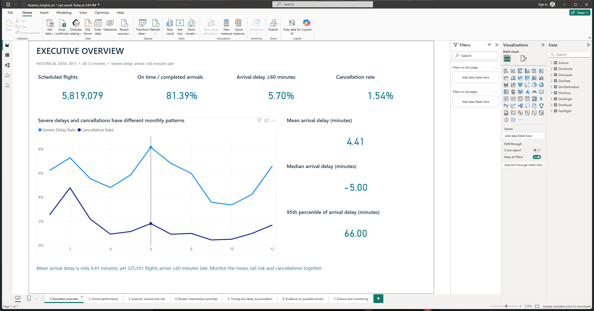

# U.S. Flight Operations & Delay Analytics

**5.8M flight records · Python · pandas · Power BI · DAX · Operational analytics**

An end-to-end investigation of flight delays, cancellations and operational reliability using **5,819,079 scheduled flight legs from 2015**. The goal is to identify where reliability problems concentrate, challenge alternative explanations and translate the evidence into practical investigation priorities.

> Historical analysis, not an assessment of current airline performance. Airport/route comparisons cover **11 resolved months**; system, airline and time metrics retain all 12 months. Associations and reported cause labels do not establish causality.



## Results at a glance

| Finding | Evidence | Decision implication |
| --- | --- | --- |
| A low average hides serious disruption | Mean arrival delay **4.41 min**, median **−5 min**, p95 **66 min**; **430,662 flights (7.40%)** cancelled, diverted or ≥60 min late | Monitor tail risk and cancellations alongside the average |
| Late-day departures have greater severe-delay risk | **8.49% at 17–21h vs 3.61% at 06–11h**, a **2.35×** risk ratio; direction persists in matched and outlier checks | Investigate recent late-day rotations and recovery capacity before proposing changes |
| Volume and rate answer different questions | ORD leads positive delay minutes; LGA stands out for risk in resolved geography | Prioritize absolute impact and reliability separately |
| Cancellation and severe-delay patterns differ | February cancellation rate **4.78%**; June severe-delay rate **8.15%** | Separate cancellation recovery and delay-propagation playbooks |
| Carrier comparisons depend on support and selection | NK standardized severe gap remains **+4.61 to +5.50 percentage points** across tested settings; MQ results change with retained coverage | Report the original, retained-subset and standardized contrasts separately |

The evening/morning risk ratio is observational, not a benefit from an intervention. No cost savings, passenger impacts or causal effects were estimated.

## Read the reports / Đọc báo cáo

| Language | Client report | Power BI download |
| --- | --- | --- |
| English | [Full client report](reports/final_analysis_report_en.md) | [English PBIX](https://github.com/MINNNZZ/flight-delay-operations-analytics/releases/download/v1.0.0/Aviation_Insights_en.pbix) |
| Tiếng Việt | [Báo cáo khách hàng](reports/final_analysis_report_vi.md) | [Vietnamese PBIX](https://github.com/MINNNZZ/flight-delay-operations-analytics/releases/download/v1.0.0/Aviation_Insights_vi.pbix) |

[Detailed Vietnamese insights](reports/bao_cao_insight_chi_tiet.md) · [Data quality](reports/data_quality_report.md) · [Robustness review](reports/skill_review/analysis_improvement_review.md) · [Tiếng Việt: giới thiệu dự án](README_vi.md)

## What this project demonstrates

- **Data quality and cleaning:** profile all rows, inspect conditional missingness and business keys, preserve meaningful extremes, and isolate unresolved airport identifiers.
- **Reproducible analysis:** retain the raw source semantics, export cleaned data, compare every source column on full readback and reconcile aggregate totals.
- **Business diagnosis:** compare airlines, origin/destination airports, routes, scheduled hours, months, tails and recorded cause categories; examine rate, exposure and contribution together.
- **Robustness:** outlier sensitivity, common-support coverage, stratified standardization, finer hour groups and paired month-stratified day-block stability checks.
- **BI communication:** seven-page English and Vietnamese Power BI reports, native visualizations and **21 reconciled DAX KPIs per language**.

The aviation investigation uses descriptive/diagnostic statistics, **not a machine-learning prediction model**. SQL is not claimed as an implementation language for this project.

## Power BI story

1. Executive overview — how large is the reliability problem?
2. Airline performance — which carriers require segment-level investigation?
3. Airports — distinguish volume from risk, within resolved geography.
4. Routes — select candidate interventions with exposure thresholds.
5. Time — investigate late-day accumulation and monthly differences.
6. Possible drivers — interpret reported causes with the right denominators.
7. Actions — proposed owners, pilot design, success measures and guardrails.

[View all English pages](powerbi/desktop/screenshots_en) · [Xem các trang tiếng Việt](powerbi/desktop/screenshots_vi)

PBIX assets contain the embedded model, so they can be viewed without a source refresh. Before refreshing, change local file paths to your machine. Menus follow your Desktop settings; technical identifiers and source cause-category terms are retained. Top airport/route lists are fixed from the baseline, not dynamically re-ranked. Bootstrap intervals and carrier sensitivity tables remain in the written reports rather than additional Desktop visuals.

## Repository layout

```text
scripts/                 Profiling, cleaning, analysis, reporting and localization
tests/                   Source-freshness and statistical behavior checks
reports/                 Bilingual client reports, figures and result tables
data/processed/          Small dimension tables; large cleaned export is excluded
powerbi/                 DAX, Power Query and Desktop/PBIP definitions
docs/                    Data setup, methodology and publication notes
requirements.txt         Core analysis dependencies
```

## Reproduce

Tested analysis environment: Python 3.13, pandas 2.3.3, NumPy 2.3.3 and matplotlib 3.10.6.

```bash
python -m pip install -r requirements.txt
python -m unittest discover -s tests -v
```

To rerun the analysis, first supply the three source CSVs described in [data setup](docs/DATA_SETUP.md), then run from this repository root:

```bash
python scripts/profile_data.py
python scripts/analyze_flights.py
python scripts/investigate_patterns.py
python scripts/review_analysis.py
python scripts/build_report.py
python scripts/verify_outputs.py
python scripts/finalize_project.py
python scripts/localize_written_report.py
```

The full export/readback needs several GB of RAM, disk space and time. No API key or cloud account is required for the Python analysis. The English report is an edited edition and must be reviewed after changing data or conclusions; it is not automatically retranslated by this sequence. Desktop refresh and native DAX verification are separate Windows steps. See [Power BI documentation](powerbi/README.md).

## Validation and limitations

- Full cleaned-export verification: **5,819,079 rows**, source values preserved, derived dates/flags and conservation checks passed.
- Published unit tests cover stale sources, interrupted profiles, readiness gates, weighted aggregation, reproducible paired blocks and selection versus standardization.
- Historical model evidence: [bilingual Desktop checks](powerbi/desktop/localization_verification.json), [English DAX results](powerbi/desktop/native_dax_results_en.json), [Vietnamese DAX results](powerbi/desktop/native_dax_results_vi.json).
- All **486,165 October flights** have unresolved numeric airport codes. No crosswalk was guessed. Geography therefore has a different scope from system-level metrics.
- Missing cause fields are largely conditional reporting; cancellations and diversions do not have eligible arrival outcomes. They must not be imputed as zero delay.
- One year of historical observations, no independently linked rotations/weather/crew records, and no passenger or financial data limit the claims.
- Day-block ranges describe stability within 2015 under the stated resampling assumptions, not future performance, count uncertainty or an intervention effect.

## Data provenance and AI assistance

The original CSV files were provided locally. Their original download provenance and redistribution terms were **not independently established**. Large raw and cleaned CSVs are excluded from normal Git objects; the PBIX release assets **do contain embedded flight records**. Expected source hashes and schema requirements are documented in [data setup](docs/DATA_SETUP.md). This repository does not assert that similarly named files downloaded elsewhere are byte-identical or grant a license to third-party data.

This is an **AI-assisted portfolio project**. AI tools supported code generation, analysis iteration, reporting, localization and Desktop automation. Computed results were checked against the source files and native Power BI engine; AI-generated explanations were constrained by data coverage and evidence. It is not presented as a deployed production system or an operational intervention with measured savings.

Historical verification files retain evidence from the original runs. Public-copy path sanitization and portability adjustments are described in [publication notes](docs/PUBLICATION_NOTES.md). No license for third-party data or assets is asserted by publishing this project.
