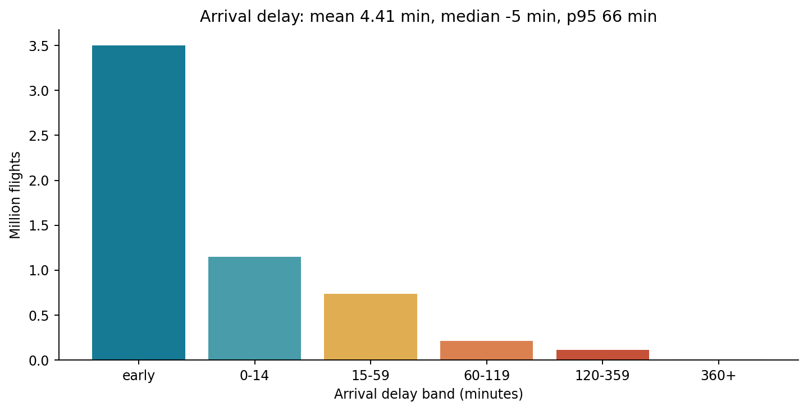
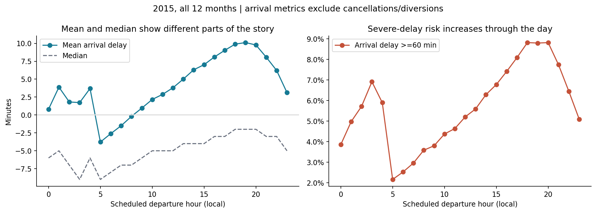
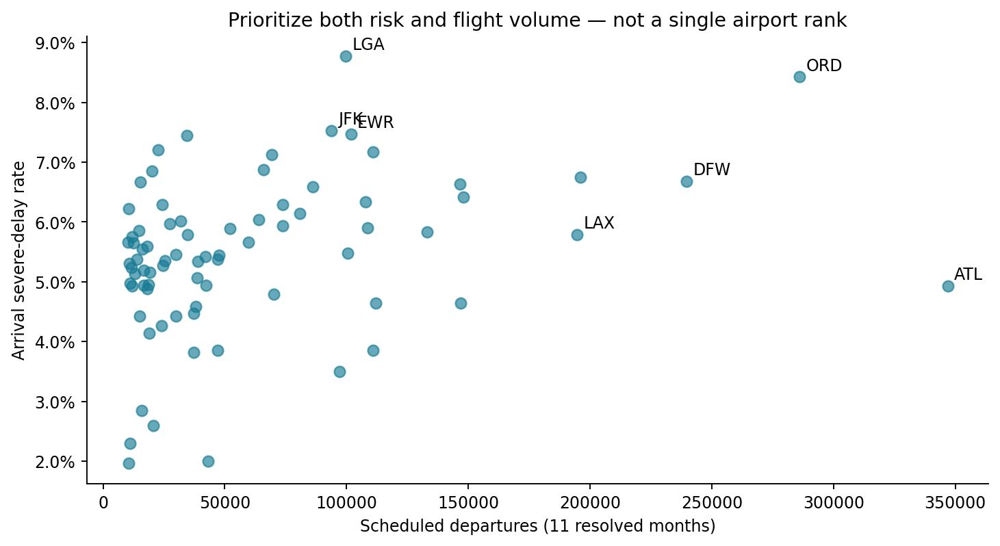
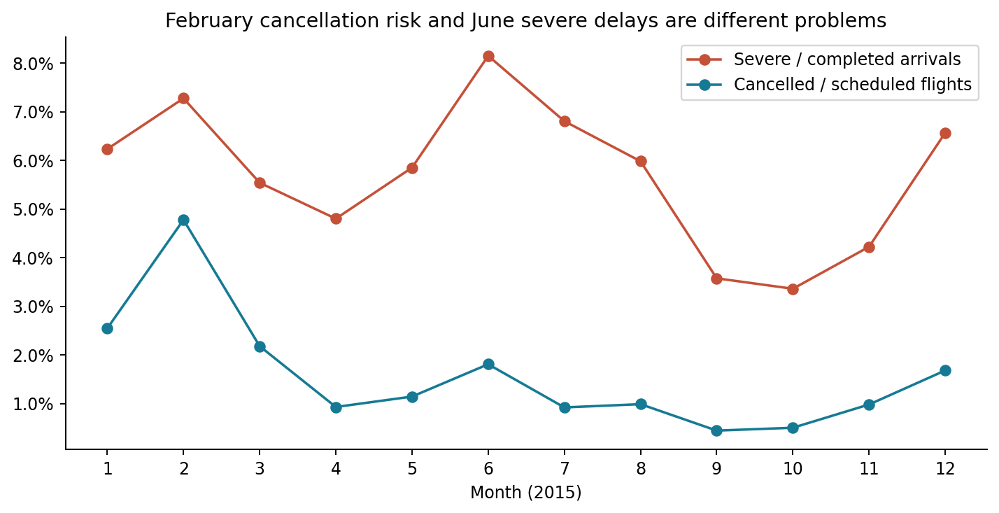
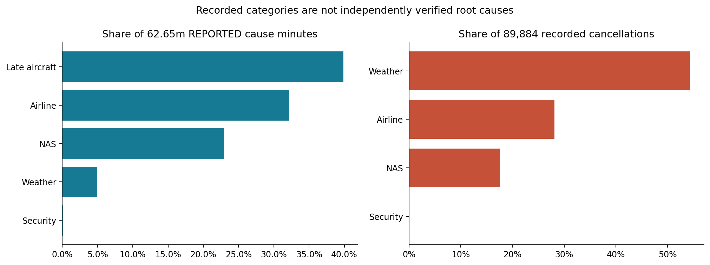

# Phạm vi và giả định

Tên dự án flight delays and cancellations project. Yêu cầu để trống câu hỏi kinh doanh; tiếp tục điều tra chậm chuyến và độ tin cậy trên dữ liệu hiện có. Đã chạy lại profiling, làm sạch, phân tích nhiều chiều và kiểm định toàn bộ bản xuất. Không sửa AGENTS.md. Không có context hoặc skill aviation-data-analysis riêng khi kiểm tra. Power BI là bản sao kiểm định trước đó; lượt này không refresh Desktop. Kiểm chứng bổ sung nằm trong báo cáo chữ.

# Chậm chuyến và hủy chuyến — Báo cáo khách hàng

Ngày hoàn tất: 12/11/2026. Kỳ dữ liệu: **01/01–31/12/2015**. Ngôn ngữ báo cáo: tiếng Việt. Phân tích toàn bộ dữ liệu, không lấy mẫu. Không sửa `AGENTS.md` hoặc dữ liệu nguồn.

# Tóm tắt điều hành

Hiệu suất trung bình tạo cảm giác khá ổn: đến chậm **4.41 phút**, median **-5 phút** (đến sớm). Tuy nhiên có **325,591 chuyến đến chậm từ 60 phút**, **89,884 chuyến hủy** và **15,187 chuyến đổi hướng**. Tổng **430,662 chuyến**, tương đương **7.40%** lịch bay, thuộc ít nhất một trong ba nhóm gián đoạn này.

Năm phát hiện chính:

1. **Rủi ro tăng rõ vào cuối ngày:** 17–21h có severe-delay rate 8.49% so với 3.61% lúc 6–11h; chênh lệch vẫn còn khi so cùng hãng–sân bay–tháng.
2. **Ưu tiên theo cả quy mô và tỷ lệ:** ORD có nhiều phút chậm dương nhất trong các sân bay đi nhận diện được; LGA có tỷ lệ chậm nặng 8.77% và hủy 4.55% trong nhóm sân bay >=10.000 chuyến. Phạm vi địa lý chỉ gồm 11 tháng.
3. **Hủy chuyến và chậm nặng có mùa khác nhau:** tháng 2 có tỷ lệ hủy 4,78%, tháng 6 có tỷ lệ chậm nặng 8,15%. Weather là mã của 54.35% chuyến hủy; không thể dùng tỷ trọng weather-delay minutes nhỏ để kết luận thời tiết không quan trọng.
4. **Cách xếp hạng hãng thay đổi quyết định:** NK cao nhất về tỷ lệ chậm nặng (10.64%); MQ cao nhất về hủy (5.10%). MQ có chênh lệch nhỏ trong tập tuyến–tháng–nhóm giờ đủ điều kiện; cần tách tác động chọn tập chuyến khỏi chuẩn hóa cơ cấu và kiểm tra theo từng giờ trước khi quy kết.
5. **Mean không phản ánh trải nghiệm phần đuôi:** p95 arrival delay 66 phút, p99 167 phút, trong khi median đến sớm 5 phút. Ngoại lệ >360 phút chỉ chiếm khoảng 0,11% chuyến hoàn tất nhưng tạo 4.64% phút chậm dương.

Ưu tiên quản trị: xác nhận các mẫu này bằng dữ liệu mới; kiểm tra lịch quay đầu/nguồn lực phục hồi cuối ngày tại ORD và LGA; tách kế hoạch ứng phó hủy chuyến mùa đông khỏi xử lý chậm dây chuyền mùa hè; giám sát kết quả bằng rate, volume và tail metrics cùng lúc. Đây là khuyến nghị điều tra/pilot có bằng chứng lịch sử, không phải chỉ đạo thay lịch hiện tại dựa trên dữ liệu 2015.

# Bài toán kinh doanh

Câu hỏi trong prompt vẫn là placeholder. Giả định đã dùng: **điều tra chậm chuyến và gián đoạn, tìm nơi/thời điểm/phân khúc bị ảnh hưởng, đánh giá driver được ghi nhận và đề xuất ưu tiên cải thiện độ tin cậy**. Quyết định cần hỗ trợ là phân bổ năng lực điều tra và phục hồi vận hành, không dự báo từng chuyến hoặc tối ưu lợi nhuận khi chưa có chi phí.

# Tổng quan dữ liệu

| Tệp | Quy mô | Grain / vai trò |
|---|---:|---|
| flights.csv | 5.819.079 × 31 | Một chuyến theo lịch, một ngày, một chặng |
| airports.csv | 322 × 7 | Một IATA airport code; tên/vị trí |
| airlines.csv | 14 × 2 | Một airline code; tên |

Đủ 365 ngày, 12 tháng năm 2015; không có ngày trống. Không có duplicate trên khóa ngày + hãng + số chuyến + sân bay đi + sân bay đến + giờ khởi hành theo lịch. `FLIGHT_NUMBER` riêng lẻ không phải primary key. `FLIGHT_ID` là surrogate key theo thứ tự dòng nguồn, không phải mã nghiệp vụ ổn định giữa các lần thay nguồn. Airport và airline là dimension many-to-one; hai vai trò airport phải được phân biệt.

Sân bay/tuyến: **5,332,914 chuyến / 11 tháng**. Tháng 10 có 486.165 chuyến dùng mã sân bay số ở cả hai đầu. Không có crosswalk đã kiểm chứng trong repo; không đoán IATA từ tên hoặc tần suất. Các chuyến này vẫn có trong KPI hãng/toàn hệ thống/thời gian.

Xem [data dictionary](data_dictionary.md) và [bảng schema/missingness](tables/quality_missingness.csv). Cột thời gian lịch là local HHMM, delay/duration là phút theo diễn giải định dạng và identities được kiểm tra. Đơn vị DISTANCE chưa có metadata nguồn xác thực; không dùng để đưa ra kết luận kinh doanh. Không có timezone/actual date offsets, aircraft type, hành khách, crew, maintenance, chi phí, thời tiết đo thực hay công suất sân bay.

# Đánh giá chất lượng dữ liệu

**READY WITH WARNINGS** cho phân tích hệ thống/hãng/thời gian. **NOT READY** cho xếp hạng tên sân bay/tuyến đủ 12 tháng hoặc mô hình quay vòng máy bay theo UTC. Chỉ phân tích địa lý trên phạm vi nhận diện được. Báo cáo chất lượng và quality gate được ghi trước EDA.

Không có trùng dòng, trùng khóa ghép, ngày/weekday lỗi, giờ HHMM sai, airline ngoài danh mục, negative duration/distance hoặc status không hợp lệ. Có 2 dòng mâu thuẫn thời gian được gắn cờ; 3 sân bay thiếu tọa độ; 6 dòng thiếu scheduled duration, tất cả thuộc hủy/đổi hướng.

105.071 giá trị ARRIVAL_DELAY thiếu khớp chính xác 89.884 hủy + 15.187 đổi hướng. Các chuyến hoàn tất có arrival delay đầy đủ. 4.755.640 NULL ở **mỗi** cột nguyên nhân là thiếu theo điều kiện báo cáo, không phải 81,72% chuyến bị mất nguyên nhân ngẫu nhiên. Tất cả 1.063.439 chuyến arrival delay >=15 có đủ năm nguyên nhân; tổng các nguyên nhân khớp arrival delay từng dòng.

Xem [đánh giá đầy đủ từng vấn đề, số dòng, rủi ro và quyết định](data_quality_report.md), [gate](quality_gate.json) và [profile](data_profile.json).

# Quyết định làm sạch

- Giữ nguyên mọi dòng và giá trị nguồn; không drop NULL/duplicate/outlier hoặc impute trung bình.
- Thêm DATE từ năm/tháng/ngày, kiểm chứng đủ 365 ngày; giờ lịch dùng DEP_HOUR và TIME_BAND. HHMM=2400 hợp lệ; không thay bằng timestamp cùng ngày hoặc tự suy UTC.
- Thêm khóa airport `__UNRESOLVED__` cho tháng 10; giữ mã gốc; cờ GEO_ELIGIBLE quyết định phạm vi địa lý. FK tới dimension xử lý có 0 giá trị không nối được, nhưng điều này không đồng nghĩa đã xác định tên sân bay tháng 10.
- Thêm TIME_ISSUE cho 2 dòng. Chuyến NK 1012 ngày 24/12 đã hủy có departure clock không khớp delay; vốn không được đưa vào mẫu số departure. Chuyến F9 1360 ngày 04/07 có duration identity lệch 2 phút, giữ arrival delay vì khớp giờ đến; không dùng để suy rotation. Sensitivity bỏ dòng này không thay đổi kết luận.
- Thêm ARR_ELIGIBLE/ON_TIME/SEVERE_60/DISRUPTED và delay analysis. ARR_DELAY_ANALYSIS chỉ chứa chuyến hoàn tất; DEP_DELAY_ANALYSIS loại hủy và departure clock lỗi, có giữ chuyến đổi hướng đã khởi hành.

Sau xử lý: **5.819.079 dòng**, xóa 0; missingness nguồn không đổi; duplicates trước/sau đều 0; toàn bộ hủy/đổi hướng và 6.089 arrival delay >360 phút được bảo toàn. Đó là kết quả có chủ đích, không phải cleaning thất bại. Xem [validation](cleaning_validation.json); dữ liệu xuất được kiểm tra lại độc lập bằng `verify_outputs.py`.

# Phương pháp phân tích

Đo KPI tổng thể, distribution và percentiles; phân đoạn theo hãng, hai đầu sân bay, tuyến, giờ lịch, thứ, tháng/mùa, tail; xem tương tác airport × hour, airline × airport, route × time và airline × route. Xếp hạng sân bay chỉ khi >=10.000 chuyến, tuyến >=1.000 chuyến; mọi bảng giữ sample size. Ngưỡng là quy tắc tránh nhóm rất nhỏ, không bảo đảm loại hết nhiễu.

Chậm nặng được định nghĩa **arrival delay >=60 phút** để phục vụ điều hành; không gán là chuẩn BTS. On-time **<15 phút** theo [định nghĩa BTS](https://www.bts.gov/explore-topics-and-geography/topics/airline-time-performance-and-causes-flight-delays). On-time/severe có mẫu số chuyến hoàn tất có delay; cancellation/diversion/disruption dùng toàn bộ lịch. Disruption là hợp không trùng của hủy, đổi hướng hoặc severe arrival.

Đây là mô tả toàn bộ tệp và chuẩn hóa phân tầng; không dùng p-value để biến chênh lệch nhỏ thành kết luận quan trọng. Không có thiết kế nhân quả. Không ép ML vì câu hỏi mang tính mô tả/chẩn đoán và các cause fields chỉ có sau kết quả, dễ gây leakage.

# Kết quả chính

| Chỉ tiêu | Giá trị | Mẫu số / phạm vi |
|---|---:|---|
| Total flights | 5,819,079 | Toàn lịch, 12 tháng |
| Completed / arrival eligible | 5,714,008 | Không hủy/không đổi hướng |
| On-time arrival | 81.39% | 4,650,569 / 5,714,008 |
| On-time trên toàn lịch | 79.92% | 4,650,569 / 5,819,079 |
| Cancellation / diversion | 1.54% / 0.26% | Toàn lịch |
| Severe arrival >=60 | 5.70% | 325,591 / 5,714,008 |
| Any major disruption | 7.40% | 430,662 / toàn lịch |
| Departure mean / median | 9.34 / -2 phút | 5,729,195 không hủy, delay hợp lệ |
| Arrival mean / median | 4.41 / -5 phút | Completed |
| Arrival p90 / p95 / p99 | 34 / 66 / 167 phút | Completed |
| Arrival min / max / std | -87 / 1.971 / 39,27 phút | Completed |
| Positive arrival minutes | 69,103,367 | Không bù trừ bằng phút đến sớm |

## So sánh hãng — mô tả, chưa điều chỉnh cơ cấu

| AIRLINE | flights | arrival_n | avg_arr | median_arr | severe_rate | cancel_rate |
| --- | --- | --- | --- | --- | --- | --- |
| NK | 117,379 | 115,193 | 14.47 | 0.00 | 10.64% | 1.71% |
| F9 | 90,836 | 90,090 | 12.50 | -1.00 | 9.06% | 0.65% |
| B6 | 267,048 | 262,042 | 6.68 | -5.00 | 7.62% | 1.60% |
| MQ | 294,632 | 278,791 | 6.46 | -6.00 | 7.40% | 5.10% |
| UA | 515,723 | 507,762 | 5.43 | -6.00 | 7.22% | 1.27% |
| EV | 571,977 | 554,752 | 6.59 | -4.00 | 6.63% | 2.66% |
| OO | 588,353 | 576,814 | 5.85 | -4.00 | 6.05% | 1.69% |
| VX | 61,903 | 61,248 | 4.74 | -3.00 | 5.80% | 0.86% |
| AA | 725,984 | 712,935 | 3.45 | -6.00 | 5.46% | 1.50% |
| WN | 1,261,855 | 1,242,403 | 4.37 | -4.00 | 5.09% | 1.27% |
| US | 198,715 | 194,223 | 3.71 | -4.00 | 4.66% | 2.05% |
| DL | 875,881 | 870,275 | 0.19 | -8.00 | 4.05% | 0.44% |
| AS | 172,521 | 171,439 | -0.98 | -5.00 | 2.95% | 0.39% |
| HA | 76,272 | 76,041 | 2.02 | -2.00 | 1.46% | 0.22% |

US chỉ xuất hiện tháng 1–6; không diễn giải thay đổi số chuyến giữa AA/US là tăng trưởng hữu cơ hoặc suy giảm vận hành. Hãng khác nhau về sân bay/tuyến/khung giờ; xem kiểm chứng ở insight 4.

## So sánh tuyến — 11 tháng, ngưỡng >=1.000 chuyến

| ROUTE | flights | arrival_n | severe_rate | cancel_rate | median_arr |
| --- | --- | --- | --- | --- | --- |
| ORD > JFK | 1577 | 1538 | 13.59% | 2.16% | -4.0 |
| LGA > GSO | 1295 | 1160 | 13.36% | 10.35% | -3.0 |
| ORD > EWR | 3874 | 3751 | 13.04% | 2.92% | -3.0 |
| RDU > LGA | 1878 | 1677 | 13.00% | 10.49% | 0.0 |
| MCO > JFK | 5346 | 5245 | 12.79% | 1.61% | -4.0 |
| RIC > LGA | 1381 | 1283 | 12.78% | 6.81% | 0.0 |
| ORD > DEN | 5613 | 5517 | 12.34% | 1.35% | 2.0 |
| CMH > LGA | 1439 | 1308 | 12.31% | 8.76% | -2.0 |

Tuyến ORD → JFK có severe rate 13,59% trên 1.538 chuyến hoàn tất, nhưng không có nghĩa đây là tuyến gây tổng tổn thất lớn nhất. Theo tổng phút chậm dương, SFO → LAX dẫn đầu (222.421 phút; 13.744 chuyến theo lịch), cho thấy rate và volume trả lời hai câu hỏi khác nhau.

# Những phát hiện có giá trị

## 1. Cuối ngày là phân khúc cần điều tra trước; khác biệt không chỉ do cơ cấu hãng/tháng

**Quan sát / Bằng chứng:** Nhóm 6–11h có 2,263,032 chuyến theo lịch (2,225,963 hoàn tất); mean arrival 0.20 phút, median -7, severe 3.61%. Nhóm 17–21h có 1,502,979 chuyến (1,470,984 hoàn tất); mean 9.47, median -2, severe 8.49% — khoảng 2.35 lần. Tỷ lệ gián đoạn gồm cả hủy/đổi hướng cũng tăng từ 5.19% lên 10.43%.

**Mẫu hình / Bối cảnh:** Mean buổi tối cao hơn ở 12/12 tháng và 14/14 hãng. Trong 5,401 phân tầng chung hãng × sân bay đi × tháng, mỗi nhóm giờ có >=30 arrival, chuẩn hóa bằng trọng số min(n_sáng,n_tối), chênh lệch mean vẫn **10.06 phút**, severe **5.26 điểm phần trăm**. Có 1,791,184 arrival sáng và 1,257,762 arrival tối trong phần so sánh này; 82.26% strata cùng chiều. So cùng tuyến × tháng cũng còn chênh lệch 10,52 phút. Đây là hai kiểm chứng riêng, không phải mô hình đã đồng thời kiểm soát mọi yếu tố.

**Kiểm chứng thay thế:** Bỏ arrival delay >360 phút vẫn có mean -0,49 phút sáng và 9,10 phút tối; median cũng dịch từ -7 sang -2. Điều này bác bỏ giải thích đơn giản rằng vài chuyến cực đoan tạo ra toàn bộ chênh lệch. Khung giờ khác nhau còn route mix/crew/demand; kết quả vẫn là association.

**Yếu tố khả dĩ:** Late-aircraft là nhóm phút nguyên nhân lớn nhất và tăng tỷ trọng vào cuối ngày, phù hợp giả thuyết chậm dây chuyền. Không chứng minh rotation cụ thể vì thiếu UTC/actual flight-date offsets và dữ liệu quay đầu.

**Ý nghĩa kinh doanh / Hành động:** Chậm cuối ngày làm tăng nhu cầu phục hồi lịch, rủi ro nối chuyến và gián đoạn tổ bay; chưa lượng hóa được hành khách/chi phí. Sau khi xác nhận bằng kỳ dữ liệu mới, thử review rotation/buffer/khả năng phục hồi 17–21h ở các phân khúc ưu tiên. Theo dõi severe/disruption rate và p95, không chỉ mean.

**Bài học:** Vì tỷ lệ được so cùng hãng/sân bay/tháng và còn sau bỏ đuôi cực đoan, kết luận mạnh hơn so với việc vẽ một đường mean theo giờ. Câu hỏi kế tiếp là rotation nào có ít recovery buffer, không phải mặc định mọi sân bay đều thiếu năng lực.

## 2. ORD nổi bật về quy mô, LGA về rủi ro; không có bằng chứng một nhóm nhỏ sân bay gây gần hết vấn đề

**Bằng chứng:** Trong 11 tháng nhận diện được, ORD có 285,884 chuyến, 4,482,201 phút chậm dương (6,86% tổng phạm vi địa lý), severe rate 8.43%. LGA có 99,605 chuyến, 94,834 arrival, severe 8.77%, hủy 4.55%, disruption 13.14%. LGA đến cũng có severe 9,44% trên 94.527 arrival.

**Mẫu hình:** Ở LGA, disruption tăng từ 8,51% sáng lên 19,64% tối; mean arrival từ -1,30 lên 14,85 phút. ORD tăng từ 8,20% lên 14,80% disruption. Có tương tác địa điểm × giờ, không nên áp một biện pháp đồng loạt cả ngày.

**Kiểm chứng / Bối cảnh:** Top 10 sân bay theo phút chậm tạo 38.30% phút chậm nhưng cũng chiếm 36.33% chuyến. Đây chủ yếu là quy mô lớn, không phải quy luật 80/20 mạnh. Top 20% tuyến theo phút chậm chiếm 61,30% severe và 56,67% chuyến trong phạm vi địa lý. Tuyến volume cao cần ưu tiên khác tuyến rate cao. Airport-origin metrics là kết quả của các chuyến đi từ đó, **không tự chứng minh sân bay đi là nơi phát sinh nguyên nhân**.

**Ý nghĩa kinh doanh / Hành động:** ORD phù hợp ưu tiên năng lực điều tra tác động lớn; LGA phù hợp kiểm tra độ tin cậy cuối ngày và hủy. Đào sâu hãng × airport × khung giờ trước khi kết luận cần tăng công suất sân bay. Chỉ dùng các kết quả này như danh sách ứng viên lịch sử vì tháng 10 chưa được nối mã.

**Bài học:** Một ranking duy nhất trộn rate và volume sẽ trả lời sai quyết định phân bổ nguồn lực. Luôn đặt cạnh nhau N, rate và contribution.

## 3. Kế hoạch ứng phó hủy chuyến cần khác kế hoạch giảm chậm nặng

**Bằng chứng:** Tháng 2 có 20.517/429.191 chuyến bị hủy (**4,78%**); tháng 6 chỉ 1,81% hủy nhưng severe arrival cao nhất **8,15%** (40.171/492.847 arrival). Tháng 10 có severe rate 3,36%, cancellation 0,50%; tháng này được giữ trong so sánh toàn hệ thống.

**Yếu tố / Bối cảnh:** Mã hủy B-weather ghi nhận **48.851/89.884 (54.35%)**; A-airline 25.262; C-NAS 15.749; D-security 22. Đây là nhóm nguyên nhân do báo cáo vận hành ghi nhận. Nhóm WEATHER_DELAY riêng chỉ chiếm 4,95% **phút nguyên nhân của chuyến đến chậm >=15**. Mẫu số và loại gián đoạn khác nhau; NAS hoặc late-aircraft cũng có thể chứa tác động thời tiết gián tiếp theo [BTS FAQ](https://www.bts.gov/explore-topics-and-geography/topics/airline-time-performance-and-causes-flight-delays).

**Kiểm chứng thay thế:** Phân tích median, severity và cancellation song song tránh thiên lệch chỉ nhìn chuyến còn hoạt động. Không gắn tháng 2 với một bão cụ thể khi không có weather observation/event log. Một năm chưa đủ chứng minh quy luật mùa lặp lại qua nhiều năm.

**Ý nghĩa kinh doanh / Hành động:** Tách hai playbook: khả năng quyết định hủy/phục hồi/đổi hành trình trong các đợt gián đoạn lớn; và kiểm tra chậm dây chuyền để bảo vệ lịch còn khai thác. Đo cancel rate, disruption rate, p95 và thời gian phục hồi, bổ sung passenger/connection data để đo hậu quả thực.

**Bài học:** Category cause không có cùng độ phủ với dữ liệu gián đoạn; một cột weather nhỏ không chứng minh thời tiết là yếu tố thứ yếu.

## 4. NK có rủi ro chậm nặng còn sau so cùng tuyến; MQ cần chú trọng hủy và cơ cấu khai thác

**Bằng chứng:** NK: 117,379 chuyến, 115,193 arrival, severe 10.64%. MQ: 294,632 chuyến, hủy 5.10%, severe 7.40%. Chỉ xét delay của chuyến hoàn tất sẽ bỏ qua nhóm hủy lớn của MQ.

**Kiểm chứng thay thế:** So cùng tuyến đi–đến × tháng × nhóm giờ, mỗi carrier và nhóm hãng khác đều >=10 arrival, dùng min(n_carrier,n_other) làm trọng số. NK có 2,879 strata, 81,016 arrival NK và 296,019 comparator; NK còn cao hơn **5.47 điểm % severe**, **11.92 phút mean**. MQ trong 2,875 strata chỉ cao hơn **0.17 điểm % severe**, mean còn thấp hơn **2.16 phút**. Mức thay đổi so với aggregate bao gồm cả chọn tập chuyến và chuẩn hóa; không thể gán toàn bộ cho cơ cấu tuyến/thời gian. Xem [kiểm chứng bổ sung](skill_review/analysis_improvement_review.md) về độ phủ và độ nhạy theo từng giờ.

**Giới hạn:** Comparator là nhóm hãng còn lại gộp; chỉ có common-support subset, loại tháng 10; BAND OTHER gộp ngoài sáng/tối. Đây không phải causal effect hoặc chứng minh toàn bộ hoạt động của NK yếu. Kiểm chứng MQ chỉ điều chỉnh chậm ở chuyến hoàn tất, **chưa điều chỉnh chênh lệch cancellation**.

**Ý nghĩa kinh doanh / Hành động:** NK là ứng viên review độ tin cậy theo tuyến cụ thể; MQ là ứng viên review hủy/khôi phục lịch và lý do hủy theo airport/tháng. Không quy vấn đề cho chất lượng kỹ thuật tàu bay từ tail ranking: N219FR có severe 13,94% trên 1.306 arrival nhưng chưa kiểm soát lịch tuyến, cũng không có maintenance logs.

**Bài học:** Khi xếp hạng thay đổi sau segmentation, nên thay đổi câu hỏi điều tra. Hãng có mean cao không mặc nhiên là nguyên nhân; cancellation và route mix phải được kiểm tra.

## 5. Mức trung bình thấp che khuất phần đuôi, nhưng vài ngoại lệ không giải thích hết vấn đề

**Bằng chứng:** Mean arrival 4,41 phút, median -5; p90 34, p95 66, p99 167; max 1.971. Có 6.089 chuyến >360 phút, khoảng 0,11% arrival, đóng góp 4,64% phút chậm dương. Loại nhóm này, mean giảm xuống 3,85 phút và severe rate còn 5,60%, so với 5,70% ban đầu.

**Diễn giải:** Median cho biết chuyến điển hình; p95 và severe rate phản ánh phần trải nghiệm kém. Cả hai cần thiết. Giá trị rất lớn có ý nghĩa về phục hồi vận hành, không nên loại để làm KPI đẹp. Tổng phút chậm dương là 69,10 triệu, trong khi mean có dấu đã được bù trừ bởi các chuyến đến sớm.

**Ý nghĩa kinh doanh / Hành động:** Có nhiều chuyến cần hỗ trợ phục hồi dù chuyến điển hình vẫn sớm; giám sát severe/disruption, p95/p99 cùng volume. Phút chậm là flight-minutes cộng qua các chuyến, không phải passenger-minutes, giờ tổ bay hay số giờ tàu bay thực mất; chậm dây chuyền có thể được ghi ở nhiều chặng.

**Bài học:** Không chọn mean hoặc median làm một “sự thật duy nhất”. Đặt chúng cạnh tỷ lệ sự kiện nghiêm trọng và tail percentiles để thấy cả tần suất lẫn mức độ.

# Điều tra nguyên nhân

| Giả thuyết | Mức bằng chứng | Kết quả / giới hạn |
|---|---|---|
| Late aircraft / propagation | Strong Evidence cho nhóm nguyên nhân ghi nhận; Moderate Evidence cho cơ chế lan truyền | 24.961.931 phút, 39,84% tổng phút nguyên nhân; pattern tối bền theo phân tầng. Thiếu linked rotation/UTC để kiểm chứng từng chuỗi |
| Airline operations | Strong Evidence cho nhóm báo cáo; Insufficient Data cho crew vs maintenance | 20.172.956 phút, 32,20%; không có logs để phân biệt cơ chế |
| NAS / capacity | Strong Evidence cho nhóm NAS; Weak Evidence cho giả thuyết “tắc nghẽn” cụ thể | 14.335.762 phút, 22,88%; NAS gồm nhiều yếu tố, không đồng nhất với thiếu capacity |
| Weather | Strong Evidence cho nhãn hủy; Insufficient Data cho attribution độc lập | 54,35% chuyến hủy mang mã weather; không có weather observation và sự kiện để xác minh |
| Time-of-day accumulation | Strong Evidence cho association; Moderate Evidence cho driver vận hành | So cùng hãng–origin–month còn +10,06 phút; không loại hết nhiễu và selection |
| Một vài extreme outliers tạo toàn bộ vấn đề | Not Supported | Bỏ >360 phút vẫn còn severe 5,60% và chênh lệch giờ |
| Airport code issue gây mọi pattern | Not Supported cho trend toàn hệ thống | Có lỗi join tháng 10, nhưng thời gian/hãng vẫn phân tích được đủ năm; địa lý đã giới hạn phạm vi |
| Aircraft-specific maintenance failure | Insufficient Data | Tail có khác biệt; không có loại máy bay, maintenance/crew hoặc phân bổ lịch đã kiểm soát |

62.651.867 phút nguyên nhân chỉ phủ **90,66%** 69.103.367 phút chậm dương, vì các chuyến chậm 1–14 phút không có báo cáo cause. Late-aircraft + airline chiếm 72,04% **reported cause minutes**; không tự quy 72,04% toàn bộ thiệt hại cho hai nhóm này. Các nhãn xác nhận được nội dung báo cáo, không xác nhận quan hệ nhân quả độc lập.

# Tác động kinh doanh

430.662 chuyến thuộc nhóm gián đoạn nghiêm trọng theo định nghĩa của nghiên cứu; 325.591 chuyến hoàn tất chậm >=60 phút là quy mô cần chú ý về phục hồi lịch và trải nghiệm hành khách. Dữ liệu không có hành khách hay connections nên không tính số người trễ nối chuyến, compensation hoặc doanh thu mất. Không gán mọi phút chậm vào chi phí hay suy ra lợi nhuận.

Các cơ chế có thể bị ảnh hưởng: tăng khối lượng xử lý đổi hành trình, áp lực quay vòng tàu bay/tổ bay và lịch cuối ngày, giảm độ tin cậy giờ đến. Đây là tác động hợp lý để điều tra, chưa phải lượng thiệt hại đã đo. Muốn định lượng tài chính cần passenger manifests/loads, nối chuyến, crew duty, aircraft rotations, recovery actions và đơn giá phù hợp.

# Khuyến nghị

| Priority / Problem | Evidence | Recommended Action | Expected Business Effect | Success Metric | Confidence / effort |
|---|---|---|---|---|---|
| High: tính cập nhật và mã sân bay | Năm 2015; thiếu geography của 486.165 chuyến tháng 10 | Data owner lấy kỳ dữ liệu mới và crosswalk airport ID có nguồn xác minh, kiểm định lại counts/ranks trước quyết định hiện tại | Tránh ưu tiên sai vì dữ liệu cũ hoặc tách mã | Airport resolution 100% hoặc documented exceptions; đủ ngày; quality gate trước refresh | Cao về nhu cầu; effort vừa |
| High: rủi ro cuối ngày | 8,49% severe tối vs 3,61% sáng; +10,06 phút sau phân tầng | Ops control review rotation, scheduled turn/buffer và recovery resources tại ORD/LGA 17–21h; pilot trên các tuyến common-support sau tái xác nhận bằng dữ liệu mới | Giảm lan truyền chậm và bất ổn cuối ngày | Severe/disruption/p95 theo airport-route-hour; cancellation không tăng khi mean giảm | Vừa về cơ chế; effort vừa |
| High: hủy khác chậm nặng | Tháng 2 hủy 4,78%; weather label 54,35% annual cancellations | Ops + customer recovery tách playbook hủy/phục hồi khỏi chương trình giảm delay của chuyến còn hoạt động; review lý do hủy theo ngày/airport | Phục hồi có trọng tâm; hạn chế chuyển vấn đề từ delay sang cancel | Cancellation + disruption đồng thời; phục hồi lịch và thời gian đổi hành trình khi bổ sung dữ liệu | Vừa; effort vừa |
| Medium: carrier/route reliability | NK còn +5,47 điểm % severe sau so tuyến-tháng-band; MQ hủy 5,10% | Airline performance team điều tra routes NK có matched excess và hủy MQ theo airport/month; không kết luận từ rank thô | Chọn đúng phạm vi sửa quy trình | Matched severe gap; cancellation adjusted mix; sample/coverage ổn định | Vừa cho NK; thấp-vừa cho cơ chế MQ; effort vừa |
| Medium: KPI che mất đuôi | Mean 4,41 nhưng p95 66 phút; 430.662 disruptions | BI owner hiển thị N, on-time hai mẫu số, cancel/divert, severe, p95 và positive minutes trong cùng dashboard | Nhận diện sớm khi chuyến điển hình ổn nhưng tail xấu | Reconciliation với fact; alerts theo baseline mới và control limits đã thỏa thuận | Cao về đo lường; effort thấp |
| Further Investigation: cơ chế thật và tác động | Không có UTC, weather/crew/cost/passenger | Nối weather thực, airport timezone/date offsets, tail rotations, maintenance/crew và connections; kiểm tra bằng pilot/control | Phân biệt driver khả thi và lượng hóa tác động | Linkage completeness; rotation propagation; passengers affected; cost model có bằng chứng | Chưa đủ dữ liệu; effort cao |

Các tác động kỳ vọng là giả thuyết can thiệp, không phải dự báo mức tiết kiệm. Không khuyến nghị tăng buffer toàn mạng trước khi biết trade-off utilization và kết quả pilot.

# Câu chuyện Power BI

Đã tạo **đặc tả 7 trang**, DAX, Power Query importer và dimension CSV. Bản Desktop và bằng chứng kiểm định được quản lý riêng tại [Aviation_Insights.pbix](https://github.com/MINNNZZ/flight-delay-operations-analytics/releases/tag/v1.0.0) và [desktop_verification.json](../powerbi/desktop/desktop_verification.json). Chạy script sinh báo cáo này không refresh hoặc kiểm định lại Desktop; sau thay dữ liệu phải đối soát bản Desktop riêng. Xem [đặc tả từng visual](powerbi_dashboard_plan.md), [hướng dẫn mô hình/đối soát](../powerbi/README.md), [measures DAX](../powerbi/measures.dax).

1. Executive Overview: quy mô và mức nghiêm trọng; hai mẫu số on-time, cancellation, severe, tail.
2. Airline Performance: xếp hạng descriptive có N và nguyên nhân cần điều tra; tránh kết luận từ rank thô.
3. Airport Performance: phân biệt rate/volume; 11 tháng, không gồm October.
4. Route Analysis: route risk và contribution, sample threshold, drill-through đúng phạm vi.
5. Time Analysis: late-day và monthly contrast; thể hiện calendar/local time.
6. Root Cause: nhóm nguyên nhân được ghi nhận, mẫu số rõ, bằng chứng/hypothesis tách riêng.
7. Recommendations: hành động, owner đề xuất, độ tin cậy, trạng thái chưa triển khai, KPI theo dõi.

# Chỉ tiêu đánh giá thành công

Trước can thiệp cần tái lập baseline bằng dữ liệu đủ mới. Đề xuất pilot 4–8 tuần với nhóm tuyến/khung giờ can thiệp và comparator cùng điều kiện; cần điều chỉnh seasonality, volume và network mix. Đây là thiết kế đề xuất, không có kết quả can thiệp trong tệp.

Primary: severe arrival rate và disruption rate ở phân khúc mục tiêu. Guardrails: cancellation/diversion không tăng; volume/coverage giữ được; p95 không xấu đi; theo dõi aircraft utilization khi có. Secondary: recorded late-aircraft minutes trên scheduled flight, on-time scheduled rate, thời gian phục hồi. Không đưa mục tiêu % giảm hoặc tiền tiết kiệm không có bằng chứng; management chốt mục tiêu sau đo baseline/pilot khả thi. Nhãn “thành công” cần cả mức cải thiện vận hành và độ tin cậy đo lường, không chỉ thay đổi mean.

# Giới hạn

- Dữ liệu 2015, không nói lên tình hình 2026; provenance gốc và process thu thập chưa có trong repo. Phạm vi đại diện là các dòng trong tệp, không tự khẳng định toàn ngành hoặc mọi hãng/flight.
- Tháng 10 chiếm 8,35% chuyến, thiếu airport crosswalk. Loại tháng này làm mean arrival từ 4,41 tăng lên 4,89 và severe từ 5,70% lên 5,91%; geography không phải baseline đủ năm. Không ngoại suy 11 tháng thành 12 tháng.
- Arrival/causes thiếu theo outcome; không missing-at-random. Chuyến hủy không có arrival delay, nên theo dõi cancellation riêng để tránh survivorship bias.
- Chỉ một năm: tháng không đủ để chứng minh mùa lặp lại. Thay đổi coverage US/AA ảnh hưởng so sánh hãng.
- Không có UTC/actual date offsets, weather observations, duty/maintenance logs, passenger/financial data. Không thể xác minh nhân quả hoặc quantification tổn thất.
- Phân tầng chỉ dùng common support và một số biến quan sát; có selection và unmeasured confounding. So route-month và airline-origin-month là các kiểm chứng riêng.
- Các nguyên nhân là nhãn reporting; NAS có nhiều cơ chế và weather có thể lan sang late-aircraft. Không diễn giải tỷ trọng như đóng góp nhân quả thuần.

# Bước tiếp theo

1. Data owner xác minh provenance/coverage và airport-ID crosswalk; refresh dữ liệu gần kỳ quyết định, giữ source immutable và rerun gate.
2. Analyst kiểm tra độ bền của các phân khúc cuối ngày, ORD/LGA, NK/MQ trên dữ liệu mới; nếu không còn lặp lại thì điều chỉnh ưu tiên.
3. Nối timezone/date offsets và rotations để kiểm tra chuyến đến trước có liên quan thế nào tới chuyến đi sau; không nối tail theo HHMM thô.
4. Nối weather thực, crew/maintenance và passenger connections để kiểm tra driver và tác động.
5. BI owner dựng Power BI theo bộ tệp cung cấp, đối soát KPI không slicer và slicer tháng 10, sau đó quản lý pilot bằng guardrail.

**Bài học quan trọng nhất:** Insight có giá trị phải sống sót qua kiểm tra mẫu số, cơ cấu, ngoại lệ và phạm vi dữ liệu. Việc tìm ra MQ không còn chậm nặng hơn nhiều sau so cùng tuyến/tháng/giờ là kết quả có ích ngang với tìm ra một “hãng xếp cuối”.

## Evidence and Reproduction

Toàn bộ số liệu có trong `reports/tables/`; `overall`, `delay_distributions`, `time_band`, `month`, `airline`, `origin`, `destination`, `route`, `cause_totals`, `cancellation_causes`, `sensitivity`, `matched_*`, `robust_*`, `pareto_*`. [Source manifest](source_manifest.json) ghi SHA-256 của nguồn và AGENTS.md; `verification.json` xác nhận readback toàn bộ cleaned export và nguồn không đổi. [README](../README.md) mô tả lệnh tái chạy.

# Kiểm chứng bổ sung và hai bản ngôn ngữ

Bản này và [bản tiếng Anh](final_analysis_report_en.md) dùng cùng dữ liệu, định nghĩa và kết luận. Dấu phân cách số có thể theo quy ước khác nhau; mã hãng/sân bay, tên cột và công thức kỹ thuật được giữ nguyên. Các số trong bảng là điểm phần trăm khi so chênh lệch tỷ lệ, không phải phần trăm thay đổi tương đối.

## 6. Khác biệt cuối ngày giữ hướng qua kiểm chứng theo khối ngày

Chênh lệch thô tối trừ sáng là 9,27 phút về mean arrival, 4,88 điểm phần trăm về tỷ lệ chậm nặng, 2,35 lần về tỷ số rủi ro và 5,25 điểm phần trăm về tỷ lệ gián đoạn. Lấy lại mẫu theo khối ngày vòng tròn trong từng tháng, giữ cặp sáng/tối cùng ngày, với 3.000 lần và seed 20261112:

| Chênh lệch | Khoảng phân vị 2,5–97,5%, khối 7 ngày |
| --- | --- |
| Mean arrival tối trừ sáng | +8,41 đến +10,13 phút |
| Tỷ lệ chậm nặng | +4,37 đến +5,40 điểm phần trăm |
| Tỷ số rủi ro chậm nặng | 2,24 đến 2,46 lần |
| Tỷ lệ gián đoạn | +4,65 đến +5,87 điểm phần trăm |

Khối 1 và 14 ngày vẫn giữ hướng: khoảng mean lần lượt là +8,56 đến +10,02 và +8,46 đến +10,09 phút. Đây là độ ổn định lịch sử năm 2015 theo giả định lấy lại mẫu, không phải sai số đếm toàn bộ file, dự báo hoặc tác động nhân quả. Nối vòng cuối–đầu tháng và không giữ phụ thuộc xuyên tháng là các xấp xỉ. Khoảng áp dụng cho chênh lệch thô 9,27 phút, không áp dụng cho chênh lệch chuẩn hóa 10,06 phút hoặc so hãng.

## Cập nhật quan trọng khi diễn giải MQ và NK

| Hãng | Chênh lệch severe thô trên 11 tháng đủ mã | Chênh lệch thô sau chọn tập đối chiếu | Chênh lệch chuẩn hóa trong tập đó |
| --- | --- | --- | --- |
| NK | +5,26 điểm | +5,36 điểm | +5,47 điểm |
| MQ | +1,94 điểm | +0,12 điểm | +0,17 điểm |

Phần lớn mức giảm của MQ đã xuất hiện khi chọn tập chuyến, trước chuẩn hóa. Không được gán toàn bộ thay đổi cho việc điều chỉnh cơ cấu tuyến/tháng/giờ.

| Hãng | Cấu hình cùng tuyến × tháng | Chênh lệch severe chuẩn hóa | Số chuyến hãng giữ lại | Độ phủ hãng trong 11 tháng đủ mã |
| --- | --- | --- | --- | --- |
| NK | Nhóm giờ, ít nhất 10 mỗi phía | +5,47 điểm | 81.016 | 77,1% |
| NK | Nhóm giờ, ít nhất 30 mỗi phía | +4,61 điểm | 48.758 | 46,4% |
| NK | Từng giờ, ít nhất 10 mỗi phía | +5,50 điểm | 44.403 | 42,3% |
| MQ | Nhóm giờ, ít nhất 10 mỗi phía | +0,17 điểm | 110.498 | 43,0% |
| MQ | Nhóm giờ, ít nhất 30 mỗi phía | +0,09 điểm | 48.369 | 18,8% |
| MQ | Từng giờ, ít nhất 10 mỗi phía | +1,23 điểm | 28.526 | 11,1% |

Phép so từng giờ của MQ chỉ có 28.561 chuyến đối chiếu, bằng 0,57% chuyến hoàn tất của các hãng khác trong phạm vi đủ mã. Cấu hình chi tiết hơn giảm gộp giờ nhưng mất nhiều độ phủ; không tự động tốt hơn về khả năng khái quát. NK giữ hướng bất lợi trong ba cấu hình; MQ chưa thể được coi ngang bằng toàn mạng. Các phép so này chưa điều chỉnh khác biệt hủy chuyến.

Bài học cho analyst: phân biệt tác động chọn tập chuyến, chuẩn hóa, liên hệ quan sát và nguyên nhân. Kết quả mạnh hơn khi đã thách thức cách giải thích ban đầu; câu hỏi tiếp theo cần gắn với phân khúc và dữ liệu còn thiếu.

## Power BI theo ngôn ngữ

- [Bản tiếng Việt](https://github.com/MINNNZZ/flight-delay-operations-analytics/releases/download/v1.0.0/Aviation_Insights_vi.pbix).
- [Bản tiếng Anh](https://github.com/MINNNZZ/flight-delay-operations-analytics/releases/download/v1.0.0/Aviation_Insights_en.pbix).

Hai bản có cùng dữ liệu và mô hình nhúng, 7 trang và 51 thành phần trực quan; công thức DAX và mã kỹ thuật giữ nguyên. Trang hành động dùng nội dung tĩnh tương đương ở hai ngôn ngữ. Nhãn nguyên nhân trong dữ liệu có thể giữ thuật ngữ nguồn; ngôn ngữ menu Desktop theo cài đặt ứng dụng. Các bảng độ nhạy và khoảng ổn định mới nằm trong báo cáo chữ, chưa thành visual bổ sung. Trạng thái kiểm định riêng của hai bản nằm trong [localization_verification.json](../powerbi/desktop/localization_verification.json); đối soát Desktop trước đó thuộc bản gốc.

Bằng chứng bổ sung: [kiểm chứng thống kê](skill_review/statistical_review.json), [độ nhạy theo hãng](skill_review/carrier_comparison_sensitivity.csv), [độ ổn định theo khối](skill_review/time_block_stability.csv).
